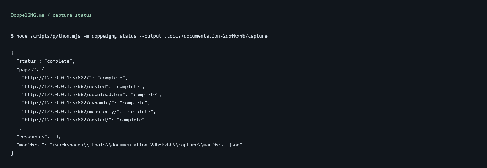

# DoppelGNG.me

DoppelGNG.me captures a website's frontend and checks whether its local copy renders and behaves like the original. It uses [WebCrawler](https://github.com/emillvl/webcrawler) for discovery and headless Waterfox for response bodies, rendered pages, and browser checks.

Use it for websites you own or have permission to reproduce. A capture preserves original responses, rewrites resources for local replay, and records screenshots, hashes, and validation results. Each completed capture is a standalone npm project.

The tool captures browser-visible files and exercised states. It cannot recover backend source, recreate an unavailable service, or guarantee that every computed external request will work offline.

## Start a capture

Source setup requires Node.js 22+, Python 3.10+, Git, and, on Windows x64, 7-Zip. Automatic browser provisioning supports Windows x64. Other platforms need explicit browser and driver paths and have not been validated. See [installation](docs/getting-started.md) for prerequisites and overrides.

```sh
git clone https://github.com/emillvl/DoppelGNG.me.git
cd DoppelGNG.me
npm install
npm run setup
npm run crawl -- --url https://your-authorized-site.example --authorized
npm run dev
```

Open the local address printed by the last command, normally `http://127.0.0.1:4173`. The example hostname is a placeholder. Replace it with your authorized target.

Setup downloads pinned crawler and browser files into `.tools/` and installs Python packages in `.venv/`. Subsequent setup verifies and reuses them. You do not need a separate Waterfox installation. On Windows NTFS, setup compresses the private browser with LZX; the measured runtime occupied about 176 MB on disk with 544 MB of logical contents.

The default output folder is the target's domain, such as `example.com/`. Choose `--output captures/example` to use another directory. Repeat the same capture command to resume that workspace. Existing unrelated folders are refused.

## What a completed capture contains

- Original response bytes in `raw/`, separate from rewritten files in `site/`.
- A manifest with resources, page states, source hashes, discovery policy, and validation results.
- Original rendered DOM, network evidence, desktop/mobile screenshots, and difference images in `artifacts/`.
- A Node replay server and `package.json`. The replay server serves archived files without fetching missing resources from the network.

By default, the browser checks 1440x900 and 390x844 content viewports at the top, middle, and bottom of each HTML page. It also compares text, headings and fonts, layout, links, controls, image loading, and browser errors. Internal navigation must pass before the capture becomes `complete`.

Disclosures such as native `details` and buttons with `aria-expanded`/`aria-controls` are discovered automatically. Other controls need [interaction scenarios](docs/cli.md#interaction-scenarios). Forms and backend operations need separate service work.

## Commands

Run these from the repository root. Put command options after npm's `--`. Replace `URL`, `PATH`, and example folder names with your own values.

### Project commands

| Task | Command |
| --- | --- |
| Install Node dependencies | `npm install` |
| Install Node dependencies from the lockfile | `npm ci` |
| Prepare dependencies | `npm run setup` |
| Check cached runtime without downloads | `npm run runtime:check` |
| Capture or resume a public website | `npm run crawl -- --url URL --authorized` |
| Capture with a login session in a fresh directory | `npm run crawl -- --url URL --authorized --output captures/private --login --login-check '#signed-in'` |
| Show capture state | `npm run status -- --output example.com` |
| Run validation again | `npm run validate -- --output example.com` |
| Validate an authenticated capture with a fresh login | `npm run validate -- --output captures/private --login --login-check '#signed-in'` |
| Serve a capture | `npm run dev -- --manifest example.com/manifest.json` |
| Export to another directory | `npm run export -- --output example.com --destination delivery/example.com` |
| Build the Windows ZIP with browser included | `npm run package` |
| Run project tests | `npm test` |
| Show capture help | `npm run crawl -- --help` |
| Show validation help | `npm run validate -- --help` |
| Show status help | `npm run status -- --help` |
| Show export help | `npm run export -- --help` |
| Show packaging help | `npm run package -- --help` |

Capture, status, validation, and export print JSON. Capture and validation exit unsuccessfully when the result is incomplete. Validation can revisit the original site for interaction checks; it is not an offline-only command.

To run a copied project, open its directory, run `npm install`, then `npm run dev`. Replay needs Node.js; it does not need Python, the crawler, or Waterfox. Export includes raw responses and browser artifacts, so review that material before sharing it.

### Capture options

Use these with `npm run crawl --`. Login options are in the next table.

| Option | Default | Purpose |
| --- | --- | --- |
| `--url URL` | Required | HTTP or HTTPS target without embedded credentials. |
| `--authorized` | Required | Confirm permission to reproduce the target. |
| `--output PATH` | Folder named after the target domain | Select the capture workspace. Public captures can resume; authenticated captures need a fresh directory. |
| `--crawler PATH` | `DOPPELGNG_CRAWLER`, otherwise `.tools/webcrawler` | Select a compatible crawler directory. |
| `--port N` | `4173` | Port for the temporary local replay server used during checks. |
| `--viewport WIDTHxHEIGHT` | `1440x900` and `390x844` | Repeat to replace the default viewports. Each dimension must be 240 through 7680. |
| `--visual-tolerance RATIO` | `0.01` | Maximum changed-pixel ratio for page screenshots, between 0 and 1. |
| `--scenarios FILE` | Saved mapping on resume, otherwise none | Load JSON interaction scenarios. A file containing `{}` clears the saved mapping. |
| `--authorize-resource-origin URL` | Saved list on resume, otherwise none | Repeat to authorize additional resource origins, including private addresses. Uses the exact scheme, hostname, and port; does not expand page scope. |
| `--respect-robots` | Enabled | Apply robots.txt rules. |
| `--ignore-robots` | Disabled | Skip robots.txt rules. Cannot be combined with `--respect-robots`. |
| `--checkpoint-every N` | `1` | Save crawler state every N pages. `0` disables periodic saves; final saves and recovery records remain enabled. |
| `-q`, `--quiet` | Disabled | Suppress progress while keeping final JSON and errors. Use `npm --silent run crawl -- ... -q` to hide npm's banner too. |

### Login options

These apply to both `crawl` and `validate`. `--login` takes no value: enter the username and password at the hidden prompts. All other login options require `--login`. See [authenticated capture](docs/authentication.md) for supported forms and privacy limits.

| Option | Default | Purpose |
| --- | --- | --- |
| `--login` | Disabled | Start an in-memory session through an ordinary HTML password form. |
| `--login-check SELECTOR` | Required with `--login` | CSS selector that must be visible on every signed-in original HTML page. Replace `#signed-in` in the examples with your site's marker. |
| `--login-url URL` | Target URL, following its login redirect | Select a login page on the same origin as the target. |
| `--login-form SELECTOR` | Unique password form | Select the form when automatic selection is ambiguous. |
| `--login-user-field NAME` | Detected username field | Select the username input by its HTML `name` attribute. |
| `--login-password-field NAME` | Detected password field | Select the password input by its HTML `name` attribute. |

### Options for other commands

| Command | Option | Default and purpose |
| --- | --- | --- |
| `status`, `validate`, `export` | `--output PATH` | Select a capture directory. Omit to use `.doppelgng/current.json`. |
| `validate` | `--port N` | Temporary replay server port; defaults to `4173`. Other capture settings come from the saved manifest. |
| `export` | `--destination PATH` | Delivery directory; defaults to a folder named after the target domain in the current directory. Must be new unless it is the source capture itself. |
| `dev` | `--manifest PATH` | Manifest to serve. Falls back to `DOPPELGNG_MANIFEST`, `.doppelgng/current.json`, then `.doppelgng/manifest.json`. |
| `dev` | `--port N` | Local server port. Falls back to `PORT`, then `4173`; binds to `127.0.0.1`. |
| `package` | `--output PATH` | ZIP filename; defaults to `dist/doppelgng.me-windows-x64.zip`. Also writes a `.sha256` file. |
| `crawl`, `status`, `validate`, `export`, `package` | `-h`, `--help` | Print usage and exit. |

For example, `npm run package -- --output dist/custom.zip` chooses a package filename. See the [command reference](docs/cli.md) for environment overrides, interaction scenarios, and exit behavior.

### Developer commands

These use the prepared project runtime. The browser checks and screenshot generator run against owned local fixtures; see [development](docs/development.md) for their outputs and requirements.

| Task | Command |
| --- | --- |
| Run one Python test module | `node scripts/python.mjs -m unittest discover -s tests -p test_resources.py -v` |
| Run the Node replay server tests | `node --test tests/server.test.mjs` |
| Run the pinned crawler's tests | `node scripts/python.mjs -m unittest discover -s .tools/webcrawler/tests -v` |
| Start the owned test website | `node scripts/python.mjs tests/fixture_site.py --port 4318` |
| Start the fixture with robots.txt blocking all routes | `node scripts/python.mjs tests/fixture_site.py --port 4318 --disallow-all` |
| Verify login, capture, validation, export, and offline replay | `node scripts/python.mjs scripts/verify_login.py` |
| Regenerate documentation screenshots and transcripts | `node scripts/python.mjs scripts/docs_screenshots.py` |
| Check the patch for whitespace errors | `git diff --check` |



Actual status output from the owned fixture, rendered as a terminal transcript. See [screenshots and run evidence](docs/screenshots.md) for capture output and the local replay.

## Documentation

| Guide | Contents |
| --- | --- |
| [Installation and first capture](docs/getting-started.md) | Requirements, setup, preview, resume, and export |
| [Command reference](docs/cli.md) | Every CLI option, environment variables, scenarios, and exit behavior |
| [Authenticated capture](docs/authentication.md) | Hidden login prompts, cookie sessions, signed-in checks, and privacy limits |
| [Capture, replay, and evidence](docs/capture-and-replay.md) | Files, manifest fields, states, validation, privacy, and network boundaries |
| [Architecture](docs/architecture.md) | Modules, crawler adapter, dependency discovery, rewriting, and integrity |
| [Distribution and licensing](docs/distribution.md) | Bundled Windows ZIP, checksums, recipient setup, and dependency notices |
| [Troubleshooting](docs/troubleshooting.md) | Setup failures, incomplete captures, missing resources, and validation differences |
| [Development](docs/development.md) | Project layout, tests, owned browser fixture, and documentation screenshots |
| [Screenshots](docs/screenshots.md) | Recorded terminal output, replay image, and fixture evidence |
| [Contributing](CONTRIBUTING.md) | Scope, changes, tests, and writing conventions |

Historical measurements and test records are in [VALIDATION.md](VALIDATION.md), [COMPRESSION_REPORT.md](COMPRESSION_REPORT.md), [AUDIT_REPORT.md](AUDIT_REPORT.md), [POST_AUDIT_VERIFICATION.md](POST_AUDIT_VERIFICATION.md), and [REAL_WORLD_TEST_EMILVALIYEV.md](REAL_WORLD_TEST_EMILVALIYEV.md). Their counts and archive checksums describe the recorded milestones. Referenced local QA artifacts are not shipped in Git.

## Authenticated capture

Ordinary HTML password forms are supported through `--login`:

```sh
npm run crawl -- --url https://your-authorized-site.example/private/ --authorized --output captures/private --login --login-check '#signed-in'
```

The command prompts for both fields without echoing them. Replace `#signed-in` with a selector visible on every signed-in HTML page. Credentials are submitted only to a POST form on the target origin. Session cookies remain in memory, and known login values are checked before capture files are written. Each authenticated capture needs a fresh output directory. See [authenticated capture](docs/authentication.md) for supported forms, verification, and cleanup.

## Limits

Computed external URLs, unexercised states, origin-dependent widgets, JavaScript/SSO/MFA login, payments, mutations, WebSockets, live streaming, and DRM are outside the supplied frontend equivalence checks. A successful capture proves the recorded checks for the discovered routes. It does not establish universal offline behavior or coverage of hidden routes.

Native capture requests allow the authorized target, explicitly authorized resource origins, and public dependencies. The original browser still executes website code and can make its own requests. External active documents are sandboxed during replay; widgets that depend on their original origin may need an integration. See [network boundaries and limitations](docs/capture-and-replay.md#network-boundaries-and-limitations).

## License

DoppelGNG.me source and documentation are available under the [MIT License](LICENSE). Bundled dependencies retain their own licenses and notices; see [THIRD_PARTY_NOTICES.md](THIRD_PARTY_NOTICES.md). Captured websites retain their existing rights and permissions.
