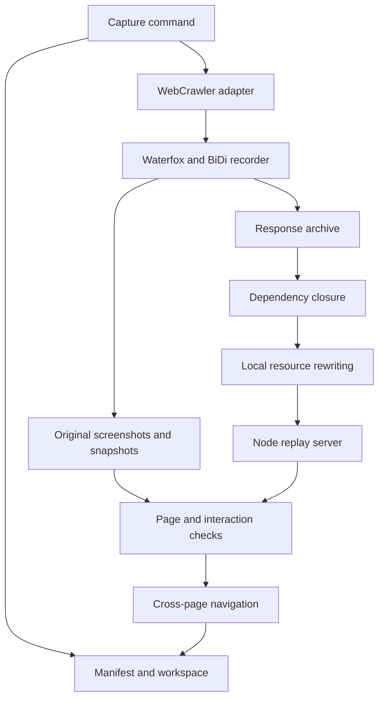

# Architecture

## Execution path

The Python process manages capture and validation. A temporary Node server serves the local copy during checks. The same server source is copied into each capture, so replay does not depend on the Python application.

## Modules

| File | Responsibility |
| --- | --- |
| `doppelgng/__main__.py` | Parse capture/status/validate/export commands and acquire operation locks |
| `doppelgng/pipeline.py` | Crawler adapter, page lifecycle, preview process, resume policy, integration |
| `doppelgng/crawler.py` | Import the configured crawler in place and record source hashes |
| `doppelgng/discovery.py` | Read same-origin sitemap indexes and page lists |
| `doppelgng/browser.py` | WebDriver session, exact content viewports, BiDi events/body collector, source fetch |
| `doppelgng/authentication.py` | Hidden prompts, same-origin HTML-form POST, in-memory cookies, signed-in checks, and known-secret write checks |
| `doppelgng/archive.py` | Ingest observed GET/HEAD responses, retrieve required resources, close dependency graph |
| `doppelgng/resources.py` | Parse HTML/CSS/JavaScript references and rewrite known URLs |
| `doppelgng/reconstruct.py` | Write local resources, update integrity metadata, invalidate changed checks |
| `doppelgng/storage.py` | Atomic manifests, raw/local hashes, page records, workspace locks |
| `doppelgng/network.py` | Origin authorization, destination checks, checked-address HTTP/TLS transport |
| `doppelgng/validation.py` | Screenshots, DOM snapshots, visual differences, interaction checks |
| `doppelgng/export.py` | Completed-workspace delivery with hash verification and staging |
| `doppelgng/dependencies.py` | Pinned crawler download, verification, and provenance |
| `doppelgng/bootstrap.py` | Browser/driver provisioning and runtime inventory verification |
| `doppelgng/compression.py` | Manifest-scoped LZX compression on Windows NTFS |
| `doppelgng/distribution.py` | Application/runtime ZIP, per-file inventory, checksum |
| `server.mjs` | Manifest-based local replay and report endpoints |
| `scripts/setup.mjs` | Venv creation, exact package installation, cached dependency checks |
| `scripts/python.mjs` | Select the interpreter and set project scratch/UTF-8 environment |

## Crawler integration

The managed crawler revision is pinned in [runtime-lock.json](../runtime-lock.json). Setup fetches only selected source, requirements, license, documentation, and regression-test files, checks their hashes, and writes an `upstream.json` receipt. It preserves the upstream files. An explicit crawler override is imported in place.

The loader isolates the upstream `signatures` import so it does not replace another installed module. It verifies the inspected WebCrawler methods before returning the module. The adapter subclasses `WebCrawler`, inherits URL normalization, link extraction, robots decisions, and the crawl loop, and replaces fetching with reconstruction work.

The inspected original crawler 2.0.0 uses requests/Beautiful Soup, a single-host LIFO frontier, tracking-parameter removal, heuristic input analysis, optional Selenium/Chrome fallback, and atomic JSON checkpoints. Its `FetchResult` carries HTML, links, and an escalation flag. It does not provide this application's resource archive or browser evidence. The managed revision uses a deduplicated FIFO frontier; the adapter handles both queue shapes. Upstream Selenium fallback is disabled because extraction uses the private Waterfox session.

The adapter replaces the upstream progress and summary output. It treats the reconstruction manifest as the resume authority because a crawler can mark a URL visited before extraction succeeds. Source hashes bind a workspace to the crawler implementation used for its capture.

## Response collection

Authenticated capture performs login before browser recording. Native sessions attach cookies only to the target's exact origin. A separate BiDi worker services blocked requests while the event-reader thread dispatches command replies. It overrides browser request cookies and removes response Set-Cookie headers, keeping the shared cookie jar in Python memory. Authenticated browser traffic permits GET and HEAD only. The event recorder removes credential headers before retaining events, and private-mode browser sessions disable driver logs and persistent caches.

Waterfox uses WebDriver for navigation and JavaScript and BiDi for network/log events. A reader thread dispatches command responses and retains events. The response collector requests up to 100,000,000 encoded bytes per collected item. The archive's default resource body limit is 256,000,000 bytes. These are implementation limits, not CLI options.

The archive records body provenance explicitly: observed BiDi body, browser fetch, browser refetch after protocol eviction, or native HTTP refetch after a browser/CORS failure. Refetching is not represented as an original recorded body. Selected representation headers, including framework prefetch headers, are retained for relevant refetches.

Same-origin observed HEAD checks can seed document retrieval. Empty speculative or cache responses do not replace a stored document. GET retrieval verifies destination policy and resource size before storage. Original and final URLs remain available where retrieval supplies them.

## Discovery and rewriting

HTML parsing uses Beautiful Soup. It collects resource attributes, responsive image candidates, stylesheet/preload links, inline styles, and scripts. CSS parsing uses tinycss2 component values so full sheets and style attributes can share URL handling.

JavaScript discovery handles explicit module and worker references and suitable `new URL(..., import.meta.url)` assets. Runtime fetches and arbitrary string literals do not automatically become invented GET requests. Computed fragments remain intact until a complete request is observed. Known complete literal URLs can be rewritten, but there is no general runtime interception layer for all computed URLs.

Dependency closure walks required parsed references and actual browser requests. Original responses remain in `raw/`. Local rewriting resolves relative URLs against the observed final response URL and honors HTML base URLs. Same-origin links retain local route paths; external navigation stays external. Cross-origin assets receive hashed local aliases. Scheme and effective port participate in origin checks.

Reconstruction writes scripts, styles, and binaries before finalizing document integrity attributes. SHA256, SHA384, and SHA512 SRI tokens are updated only if the original response passes its strongest supported original integrity algorithm. An original integrity failure stays a failure. HTML dependencies with integrity metadata are finalized in dependency order; cycles have no stable ordering and are rejected.

## Storage and recovery

`Store.resource` hashes original contents, repairs a corrupt raw file from verified incoming bytes, and retains intact rewritten local bytes when the original is unchanged. It invalidates dependent pages when source bytes, render-relevant metadata, or transformed bytes change.

Workspace locks use `msvcrt.locking` on Windows and `fcntl.flock` on POSIX. Active legacy PID locks remain respected. OS locks release after process exit; corrupt abandoned metadata does not require deleting a lock file. JSON writes stage in the destination directory and atomically replace the destination.

Operation contexts record incomplete state and an error before propagating failures. Export stages in a separate sibling directory, verifies the copy, and renames it only after successful verification. Failed staging output remains available for diagnosis.

## Current scaling limits

The manifest is serialized as one JSON value. Replay reparses it and scans resource records for each request; lookup remains linear in the resource count. Browser events accumulate during a session. Resource bodies are processed individually, while SRI caches retain digests rather than copies of the full graph.

The historical [post-audit measurements](../POST_AUDIT_VERIFICATION.md) cover controlled graph, binary, replay, and browser workloads. They do not establish throughput or memory bounds for arbitrary sites or long captures. Profile a representative workload before changing the storage or replay design.
