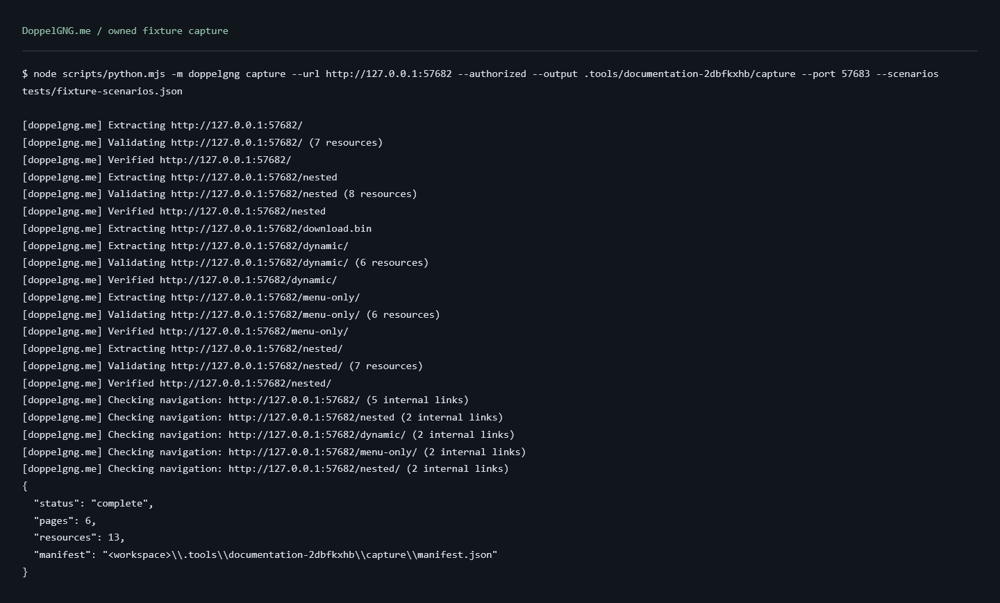
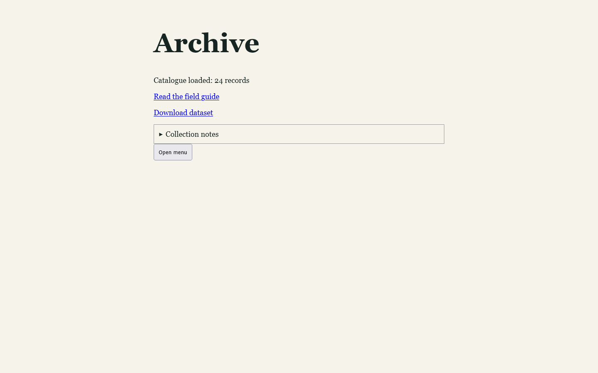

# Screenshots

These images come from the repository's owned regression website. The terminal panels render actual command output in Waterfox; they are not desktop-terminal captures. Only the absolute workspace path is replaced with `<workspace>`. The target and preview ports are local ports from the recorded run.

## Capture output

[Plain-text capture transcript](assets/terminal-capture.txt).

## Saved status

[Plain-text status transcript](assets/terminal-status.txt).

## Local replay

This is the copied fixture at a 1440x900 content viewport. It includes captured JSON content, a computed script, CSS, an image, links, and disclosure controls. It is an example of the fixture's captured state, not a certification of another website.

The [run summary](assets/fixture-evidence.json) records the resulting page/resource counts and visual/navigation measurements. The [development guide](development.md#documentation-screenshots) describes how to regenerate the images. Full raw responses and browser logs stay in ignored local directories.
